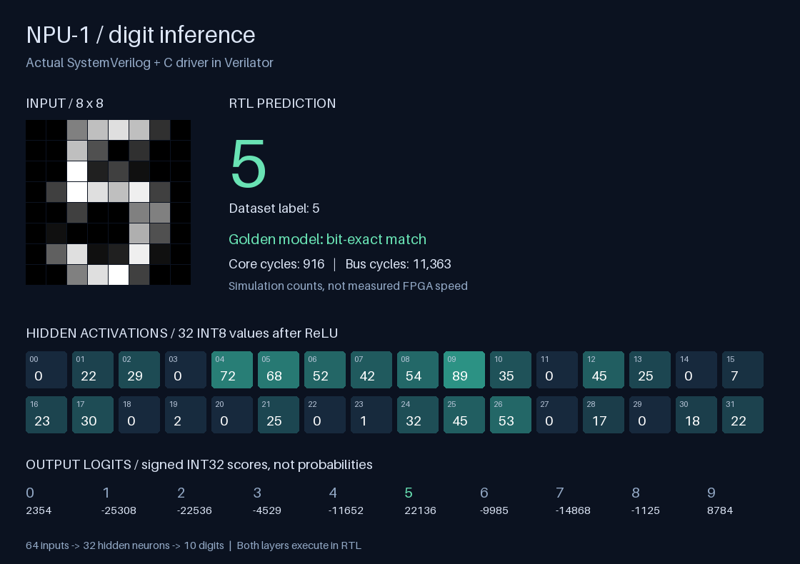

# NPU-1

[](https://github.com/shmoos/npu-1/actions/workflows/verify.yml)

A real SystemVerilog INT8 inference accelerator learning project. The portable RTL and C host driver run together in Verilator on macOS Apple Silicon or Linux. **Physical FPGA deployment has not been performed.**

The current design has a parameterized output-stationary array (default 4×4), signed 8×8→16 multiplication, 32-bit accumulation, 8 KiB of banked operand RAM, a tile controller, bias/ReLU/requantization, and an AXI4-Lite register interface. The fixed host ABI operates a 4×4 tile with `1 ≤ K ≤ 1024`; the host tiles larger M and N.

The included 64→32→10 digits MLP executes both layers through the RTL. Its **hidden activations and logits match the NumPy reference bit for bit**, with **344/360 correct classifications (95.56%)** at batch sizes 1 and 4. These are local RTL simulation results, not measured FPGA throughput.

## Start here

```sh
git clone https://github.com/shmoos/npu-1.git
cd npu-1

# Install the pinned OSS CAD Suite using docs/toolchain.md first.
# Put its bin directory on PATH; install Xcode Command Line Tools on macOS.
python3 -m venv .venv
source .venv/bin/activate
python -m pip install -r requirements.lock.txt
make regression
```

Use Python 3.11 or newer and the [pinned OSS CAD Suite 2026-10-29](docs/toolchain.md). CI tests Linux and Apple Silicon macOS; Verilator 5.020 is unsupported. Existing Python environments can use `make PYTHON=python3 regression`. Builds run in a fresh temporary path without spaces, so this repository can remain in `Chip Project/npu-1`.

- `make predict SAMPLE=0` or `make predict IMAGE="digit.png"`: run one image through RTL; see its prediction, hidden activations, logits and cycles in `artifacts/prediction/report.png`. [Demo guide](docs/image_demo.md).
- `make demo`: 480 GEMMs from three independent arithmetic seeds, all 360 digits at batch sizes 1/4 under three AXI timing seeds, concurrent read/write stress, resets and watchdog recovery.
- `make formal`: induction proofs for PE control and AXI response stability/accounting, with cover witnesses. [Proof scope](formal/README.md).
- `make regression`: lint, Python reference tests, self-checking SV PE/array/core/bus tests, rectangular array timing tests, the full workload and image-demo smoke tests.
- `make lint`, `make test-pe`, `make test-array`, `make test-core`, `make test-axil`, `make test-model`: individual checks.
- `make host`: compile the hardware validation CLI without the AWS SDK; it deliberately refuses to emulate AWS. See the runbook for the SDK build.

Read [the Obsidian roadmap](docs/00-Roadmap.md), [architecture and timing](docs/architecture.md), [arithmetic](docs/arithmetic.md), [register protocol](docs/register_map.md), [verification evidence](docs/verification_plan.md), and [AWS F2 runbook](docs/aws_runbook.md).



## Evidence and boundaries

`reports/regression.json` records source hashes, tools, exact commands, exit codes and durations. Logs live in `artifacts/verification/`. A failed run records failure and returns nonzero. Individual targets do not replace the full regression report. CI runs on pushes and pull requests using `.github/workflows/verify.yml`. See [GitHub Actions](https://github.com/shmoos/npu-1/actions/workflows/verify.yml) for remote run status.

AWS staging is pinned to an inspected official developer-kit commit. Staging validation is not AWS shell simulation. Vivado synthesis, BRAM/DSP inference, timing closure, AFI creation, hardware correctness, FPGA performance and power remain unverified. No AWS resources were created or charged by this work. This project does not claim an ASIC.

`legacy/` preserves the original learning baseline and selected draft material for comparison; it is excluded from current testing. Its old reports and claims are historical. The active source was adapted from both existing local versions, then corrected and revalidated; see [provenance](docs/provenance.md). No publishing license has been selected for the active project.
