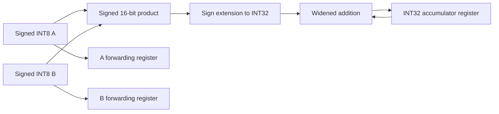

# NPU-1 initial hardware contract

Status: the single PE, skew feeders, and 4×4 array are implemented. The tile engine, memory map, host runtime, and AWS wrapper remain planned.

## Processing element

One accepted multiply–accumulate operation computes `acc_next = acc + A*B`. Two validity bits must both be set. A and B still forward independently on every enabled step, including a bubble; their validity bits identify whether the forwarded operands are meaningful.

| Signal | Width | Meaning |
|---|---:|---|
| `clk` | 1 | Rising edge updates state |
| `reset` | 1 | Synchronous active-high reset; highest priority |
| `clear` | 1 | Clear sum and forwarding state before a new dot product |
| `step` | 1 | Advance all PE state; otherwise hold |
| `a_in`, `b_in` | 8 each | Signed two's-complement operands |
| `a_valid`, `b_valid` | 1 each | Independent input validity |
| `a_out`, `b_out` | 8 each | Registered forwarding outputs |
| `a_valid_out`, `b_valid_out` | 1 each | Registered forwarding validity |
| `acc` | 32 | Signed accumulator, visible after the updating edge |

## Edge priority

1. Reset clears all registers, regardless of the other inputs.
2. Otherwise clear clears all registers, even if step is zero. Both input-valid bits must be zero for clear.
3. Otherwise step advances operand and validity registers. The accumulator advances only when both input-valid bits are high.
4. Otherwise every register holds. A stalled cycle does not consume its operands.

The core begins with reset; do not depend on simulation power-up values. Drive inputs while the clock is low and compare outputs after the next rising-edge update. Clear and the first valid product occupy separate edges.

## Arithmetic

The full signed operand range is −128…127. A signed 16-bit product covers every pair, including `−128 × −128 = 16384`. Sign extension precedes the addition. A 33-bit intermediate makes overflow detectable during simulation; legal results are stored in 32 bits.

The tile-level design will limit K to 1024. Its conservative dot-product bound is `1024 × 16384 = 16,777,216`, below the signed INT32 maximum. The PE itself has no K counter: the future controller is responsible for the operation length. Overflow is a protocol violation detected by an assertion, not a saturating arithmetic feature.

The hardware model uses fixed-width arithmetic. The software oracle uses unbounded Python integers, independently checked against NumPy INT64 dot products, to avoid copying hardware overflow mistakes into the expected values.

## Directed trace

The directed regression performs this sequence. Inspect `artifacts/verification/pe_directed.vcd` alongside the per-edge expected values in `directed.txt`. The scoreboard checks every accumulator and forwarding output.

| Edge index | Operation | A | B | Valid A/B | Step | Accumulator after edge |
|---:|---|---:|---:|---|---:|---:|
| 0 | Reset | 99 | 99 | 1/1 | 0 | 0 |
| 1 | Clear | 0 | 0 | 0/0 | 0 | 0 |
| 2 | First MAC | 1 | 4 | 1/1 | 1 | 4 |
| 3 | Pause | 127 | 127 | 1/1 | 0 | 4 |
| 4 | B invalid | 90 | −90 | 1/0 | 1 | 4 |
| 5 | A invalid | −7 | 12 | 0/1 | 1 | 4 |
| 6 | Second MAC | −2 | 5 | 1/1 | 1 | −6 |
| 7 | Third MAC | 3 | −6 | 1/1 | 1 | −24 |
| 8 | Bubble | 0 | 0 | 0/0 | 1 | −24 |
| 9 | Clear | 0 | 0 | 0/0 | 1 | 0 |
| 10 | Extreme product | −128 | −128 | 1/1 | 1 | 16,384 |
| 11 | Reset overrides clear/valid | 127 | 127 | 1/1 | 0 | 0 |
| 12 | Restart after reset | −128 | 127 | 1/1 | 1 | −16,256 |

The pause at edge 3 holds forwarding outputs as well as the sum. Edges 4 and 5 forward new operand data and validity while leaving the sum unchanged.

## Implemented systolic array

The array connects A rightward and B downward, with one register hop per PE. The external input at enabled step k is four packed A row values and four packed B column values. The internal feeders delay lane i by i enabled edges. Row i therefore receives A at step k+i and column j receives B at k+j. Each PE consumes the matching reduction index at step k+i+j.

After K aligned input vectors, supply six enabled invalid-input edges to drain the array. This is K+6 compute steps in total, excluding clear and any global pauses. At K=4 it is ten enabled edges. Every pause freezes both feeders, all PE registers, and the verification token counter. The output bus packs 16 INT32 sums in row-major order; PE (i,j) occupies bits `32*(4*i+j) +: 32`. Input lane 0 occupies bits 7:0.

Array clear masks in-flight internal validity before clearing every PE and feeder. External validity must be zero during clear. This allows an explicit clear to discard a partially completed wave without false internal clear/valid violations. Reset can abort at any point.

With `NPU_SIM_TAGS` enabled, verification-only token IDs travel with the expected lane delays and data hops; every actual valid operand pair is checked for equal token identity. These tags have no production ports. The C++ scoreboard independently checks all 16 sums and outgoing operand data/validity after every edge, against a Python input-history oracle. Final tiles are also checked against NumPy INT64 matrix multiplication.

### Hand trace of a 2×2 subarray

Take `A=[[1,2,3],[4,5,6]]` and `B=[[7,8],[9,10],[11,12]]`. The top-left 2×2 output is `[[58,64],[139,154]]`. Pad the remaining lanes with zeros when embedding it in the 4×4 array.

| Enabled step | PE(0,0) | PE(0,1) | PE(1,0) | PE(1,1) |
|---:|---:|---:|---:|---:|
| 0 | 7 | 0 | 0 | 0 |
| 1 | 25 | 8 | 28 | 0 |
| 2 | 58 | 28 | 73 | 32 |
| 3 | 58 | 64 | 139 | 82 |
| 4 | 58 | 64 | 139 | 154 |

PE(1,1) finishes two enabled steps after PE(0,0). A full 4×4 tile has a six-step corner-to-corner delay. The directed trace is saved as `artifacts/verification/array_directed.vcd`.

The buffers, synchronous-read latency, host packing, register map, and quantization modes remain proposed contracts in sections 2 and 3 of the parent roadmap. The current array accepts input vectors directly; it has no memory-mapped interface or automatic tile controller yet.
