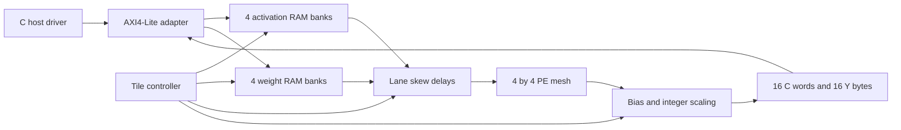

# Architecture and timing

[[00-Roadmap]] · [[arithmetic]] · [[register_map]]

## One command

Compute `C = A[M,K] × B[K,N]` for M,N in 1…4 and K in 1…1024. A host command chooses raw INT32, saturated biased INT32, or biased/requantized/ReLU INT8 output. Results occupy fixed 4×4 slots; only the declared M×N rectangle is meaningful. Host software tiles larger M and N. K splitting is intentionally unsupported.

## Learn from your ALU

An ALU computes a result from current inputs. A PE adds persistent state: on an enabled edge it forwards operands to its neighbors and, if both valid flags are set, adds their signed product to its accumulator. Nonblocking assignments mean every PE sees its neighbors' **previous** registers on that edge. The product is explicitly 16 bits and sign-extended to 32 bits. Reset and clear take priority over step; step=0 freezes data, valid bits and sums.

`mac_pe.sv` contains the datapath. `skew_feeder.sv` delays A row r by r enabled edges and B column c by c edges. `systolic_array_4x4.sv` uses positive `ROWS` and `COLS` parameters; its name preserves the original project API. `npu_core.sv`, its RAM banks, controller, and the host ABI are deliberately fixed at 4×4.

## Why the skew is necessary

At logical input step k, supply all A[r,k] and B[k,c]. After skew and forwarding, they meet at PE[r,c] on enabled edge `t=k+r+c`, counted from t=0 at the first edge consuming k=0. Without the skew, different reduction indices would meet and yield plausible but incorrect products.

| Enabled edge | PE[0,0] | PE[0,1] | PE[1,0] | PE[1,1] |
|---|---|---|---|---|
| 0 | k=0 | — | — | — |
| 1 | k=1 | k=0 | k=0 | — |
| 2 | k=2 | k=1 | k=1 | k=0 |

For K tokens, the last product reaches PE[R−1,C−1] at t=K−1+R+C−2. A 4×4 array therefore needs six enabled drain edges after the last input. The controller conservatively includes a settling transition before reading accumulators. Global stalls freeze feeder and mesh together. Arbitrary per-lane valid holes are permitted at the array boundary; a product contributes only when both flags associated with that same input step are true.

The independent SV timing oracle uses input history and `t-r-c`, not a copy of the RTL pipes. It checks every accumulator after every edge on 1×1, 3×5 and 4×4 arrays, including random holes and pauses.

## Local memory and ownership

Each operand buffer is four banks of 256×32 bits (4 KiB total). Byte write enables let a host pack four adjacent K values into a word. A bank has one write port and one synchronous read port. Host and compute **share** the read port: while BUSY, buffer access returns SLVERR. The compute address reads one word from every bank each cycle, then selects the appropriate byte. This avoids a multiported RAM requirement. HDL requests block RAM; actual FPGA resource inference must be checked in Vivado.

Contents are not reset. The host must initialize all K used bytes in each active lane before START. Unused lanes have valid=0. The C/Y buffer is small enough to be registers and is overwritten for every tile. Inactive output slots are unspecified and must be ignored.

The RAM samples an address at an edge; its output changes after that edge. The AXI adapter latches a read request and responds on the following edge. Reading the RAM's old output on the address handshake was an inherited defect, now covered by consecutive-address and changing-address-after-handshake tests.

## Controller

`IDLE → CHECK → CLEAR → PREFETCH → RUN → DRAIN → POSTPROCESS → DONE → IDLE`.

1. START latches the full configuration and clears stale DONE.
2. CHECK rejects illegal dimensions, mode or requantization parameters.
3. CLEAR discards PE and skew state.
4. PREFETCH accounts for one synchronous RAM read cycle.
5. RUN consumes K successive operands without external stalls.
6. DRAIN lets in-flight valid tokens finish.
7. POSTPROCESS visits 16 outputs; registered valid aligns each result with its store index.
8. DONE publishes the sequence number and the busy-cycle count after all stores.

A software reset aborts work, flushes valid pipelines, clears status, and suppresses the abort-edge store. RAM contents are retained. A 50,000-cycle watchdog can force an error; its assignment has priority over normal FSM transitions. The watchdog fault path has not been forcibly exercised. Start/config/RAM writes while busy are rejected at the AXI adapter. The direct core interface is an internal trusted interface, not a second host protocol.

The cycle counter measures controller active cycles, excluding host operand loading and result reads. It is not a PCIe timer. For real performance, record host monotonic times separately.

## Intentional limits

Single command in flight; no DMA, DDR/HBM traffic, interrupts, sparsity, convolution engine, K tiling or double buffering. One combinational INT64 scaling path is convenient for learning but may limit clock frequency. If timing fails, pipeline post-processing and update valid/store timing before claiming an FPGA clock rate.
